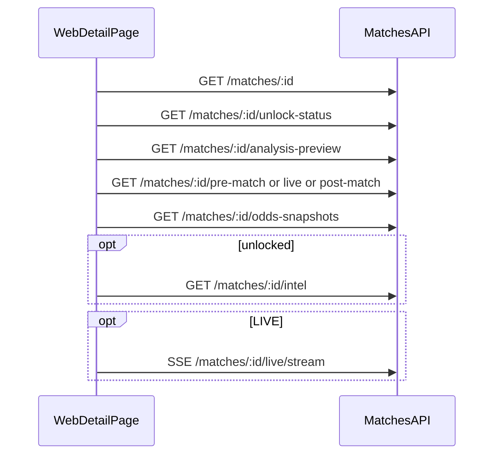

# Web 比赛详情对接说明

> **日期**：2026-05-16  
> **API**：`https://oaifjhzmpswi.sealosbja.site`（无 `/api` 前缀）  
> **前端**：`https://oovxhxiusmdy.sealosbja.site`  
> **统一响应**：`{ success, data, message }`（SSE 除外）

---

## 1. 页面加载顺序

建议首屏并行请求（`matchId` 为列表/路由带入的 **cuid**）：

| 顺序 | 接口 | 鉴权 | 说明 |
|------|------|------|------|
| 1 | `GET /matches/:id` | 无 | 头图、比分、赛事、`unlockPrice`、`predictionPreview` |
| 1 | `GET /matches/:id/unlock-status` | Bearer（可选） | 已登录时查是否已解锁 |
| 1 | `GET /matches/:id/analysis-preview` | 可选 Bearer | 契约 **analysis-preview-v1** |
| 2 | 按 `status` 选一路 | 可选 Bearer | `pre-match` / `live` / `post-match`（`match-phase-v1`） |
| 2 | `GET /matches/:id/odds-snapshots` | 无 | 赔率快照 |
| 3 | `GET /matches/:id/intel` | Bearer | **仅已解锁**拉全文 |
| 赛中 | `GET /matches/:id/live/stream` | 见 API §5.1 | SSE；勿与 REST 轮询混用同一区块 |



**勿调用** Admin 路由（如 `/admin/matches/:id/tactics`）；C 端用 `analysis-preview` 与 `intel`。

---

## 2. 字段边界

| 能力 | 接口 | 内容 |
|------|------|------|
| 分析页 Teaser | `analysis-preview` | 战术条数/标题、Fantasy 摘要、交锋统计、球员情报条目；未解锁含 `locked: true` |
| 付费全文 | `intel` | 与解锁态一致的多模块长文 |
| 三页叙事 | `pre-match` / `live` / `post-match` | `narrative`、结构化块；与 `intel` 分工，避免三处重复粘贴 |

`analysis-preview` 的 `meta.fieldBoundary` 与 [API接口对接文档-完整版.md](./API接口对接文档-完整版.md) §2.7 一致。

---

## 3. 解锁态

- `GET /matches/:id/unlock-status` → `data.isUnlocked`
- `analysis-preview` / `intel` 的 `isUnlocked` 应与上式一致
- 未解锁：`playerIntelligence.items[].locked`、`fantasy.locked`、`headToHead.locked` 等

---

## 4. curl 验收（公网）

将 `MATCH_ID` 换为真实场次（非历史种子 `seed-match-admin-showcase`）：

```bash
API=https://oaifjhzmpswi.sealosbja.site
MATCH_ID=你的比赛cuid

curl -sS "$API/matches/$MATCH_ID" | jq '.success, .data.id, .data.status'
curl -sS "$API/matches/$MATCH_ID/analysis-preview" | jq '.data.meta, .data.tactics.count, .data.playerIntelligence.count'
curl -sS "$API/matches/$MATCH_ID/pre-match" | jq '.data.meta.contractVersion, .data.narrative != null'
```

若 `tactics` / `playerIntelligence` 为空，多为库内未跑情报管线，见 [docs/比赛数据管线运维说明.md](./docs/比赛数据管线运维说明.md)。

---

## 5. 相关文档

- [后端接口需求—web前端.md](./后端接口需求—web前端.md) §3.2  
- [API接口对接文档-完整版.md](./API接口对接文档-完整版.md) §2.7  
- 积分榜 / 球员榜：[API §2 P2](./API接口对接文档-完整版.md) — `GET /leagues/standings`、`GET /rankings/players`
