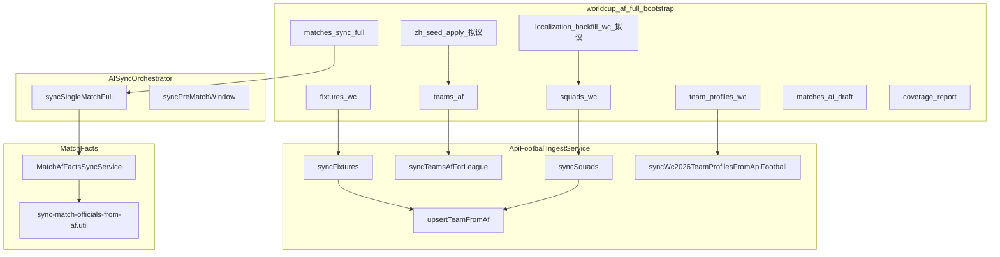

# 中文本地化 × 入库链路挂钩清单

> 一页速查：与 **API-Football 入库**、**世界杯 Bootstrap** 相关的现有文件、中文现状、拟议 Hook 插入点。  
> 主方案：[localization-zh-CN-v1.md](./localization-zh-CN-v1.md)

**图例**：**已实现** = 仓库当前行为；**拟议** = v1 方案待开发。

---

## 1. 流程总览



---

## 2. 世界杯 Bootstrap 步骤对照

定义：[world-cup-bootstrap.service.ts](../src/world-cup/world-cup-bootstrap.service.ts) `STEPS`  
任务定义：[ingest-bundle.definitions.ts](../src/data-pipeline/ingest-bundle.definitions.ts) `worldcup_af_full_bootstrap`

| 步骤 id | 当前实现 | 本地化相关数据 | Hook / 备注 |
|---------|----------|----------------|-------------|
| `catalog_verify` | `catalogVerify()` | — | — |
| `fixtures_wc` | `afIngest.syncFixtures` + `validateWcFixtureTeams` | Team（`upsertTeamFromAf`）、Match、`city`/`stadium` | **拟议** `onMatchUpsert`；球队经 fixture 主客 upsert |
| `teams_af` | `syncTeamsAfForLeague` | `Team.nameCn` ← **已实现** `AfTeamNameOverride` | **拟议** `onTeamUpsert`；覆盖表迁移到 `EntityTranslation` |
| `squads_wc` | `syncSquads` | `Player`：`nameCn=nameEn`，`avatarUrl`←`photo` | **拟议** `onPlayerUpsert` |
| `standings_wc` | `StandingsMaterializeService.syncCode` | 积分榜队名读 `Team.nameCn` | 展示层 **拟议** `DisplayNameService` |
| `leaderboards_wc` | `syncWcLeaderboardsFull` | 球员名读 `Player` | 同左 |
| `team_profiles_wc` | `syncWc2026TeamProfilesFromApiFootball` | `wc2026Profile`、`historicalHeritageZh`（中文**段落**） | 非人名；manual 中文在 `wc2026Profile.manual` |
| `zh_seed_apply` | — | 种子导入 | **拟议**，建议在 `team_profiles_wc` 之后 |
| `localization_backfill_wc` | — | WC 范围 backfill | **拟议**，建议在 `matches_sync_full` 之前 |
| `matches_sync_full` | `afSync.syncSingleMatchFull`（批量） | `MatchAfRawBundle`、facts、coach、referee | **拟议** hook + 字典 |
| `matches_pre_match_snapshot` | `MatchAfPreMatchSnapshotService` | 快照数值，非译名 | — |
| `matches_prediction_af` | `PredictionService` | DeepSeek 润色用 `nameCn\|\|nameEn` | **拟议** displayName |
| `matches_weather_t24` | `WeatherService` | `city` 英文 lookup | **拟议** `cityCn` 映射 |
| `matches_ai_draft` | `AiReportService.generate` | dossier 队名 | 应在 **zh_seed + backfill 之后** |
| `coverage_report` | `WorldCupCoverageService` | AF 端点覆盖 | **拟议** `zh_coverage_report` 中文覆盖率 |

---

## 3. 核心入库文件清单

### 3.1 P0 — 必须挂钩

| 文件 | 关键符号 | 现状（中文） | 拟议改动 |
|------|----------|--------------|----------|
| [api-football-ingest.service.ts](../src/api-football/api-football-ingest.service.ts) | `upsertTeamFromAf` | `nameCn = nameEn`；`logoUrl` 从 AF `logo` | 后接 `localizationHook.onTeamUpsert(team)` |
| 同上 | `syncTeamsAfForLeague` | 读 `prisma.afTeamNameOverride` 写 `nameCn` | 保留至迁移完成；或双写 `EntityTranslation` |
| 同上 | `syncSquads` | 球员 `nameCn=nameEn`；`avatarUrl` 来自 `p.photo` | 后接 `onPlayerUpsert` |
| 同上 | `syncFixtures` | 每场主客 `upsertTeamFromAf` | 球队 hook；Match 创建后 `onMatchUpsert` |
| 同上 | `syncWc2026TeamProfilesFromApiFootball` | 写 `historicalHeritageZh` | 与译名体系并行，不替代 |
| [world-cup-bootstrap.service.ts](../src/world-cup/world-cup-bootstrap.service.ts) | `STEPS` / `run()` | 13 步，无 zh 步 | 增加 `zh_seed_apply`、`localization_backfill_wc` |
| [af-sync-orchestrator.service.ts](../src/api-football/af-sync-orchestrator.service.ts) | `syncSingleMatchFull` | 写 bundle：fixture/lineups/events/statistics/injuries/predictions/odds 等 | Match 级 hook；响应组装用字典 |
| [match-af-facts-sync.service.ts](../src/api-football/match-af-facts-sync.service.ts) | `syncByMatchId` | `coachProfile.apiFootball.lineupCoach` | `onCoachSeen` |
| [sync-match-officials-from-af.util.ts](../src/api-football/sync-match-officials-from-af.util.ts) | `syncMatchOfficialsFromAfFixture` | `Referee.nameCn = nameEn = 英文字符串`；无 `avatarUrl` | `onRefereeSeen(normalizedKey)` |

### 3.2 P1 — 联赛管线与运维

| 文件 | 关键符号 | 现状 | 拟议 |
|------|----------|------|------|
| [ingest-orchestrator.service.ts](../src/data-pipeline/ingest-orchestrator.service.ts) | `executeBundle` | `squads`、`fixtures`、`teams_af` 等 step | step 后可选 `localization_backfill` |
| [ingest-bundle.definitions.ts](../src/data-pipeline/ingest-bundle.definitions.ts) | `worldcup_af_full_bootstrap` | 13 步文案 | 同步新 step id |
| [ingest-orchestrator.service.ts](../src/data-pipeline/ingest-orchestrator.service.ts) | `runWorldCupAfFullBootstrap` | 薄封装 → `WorldCupBootstrapService` | 无变更 |
| [world-cup-admin.controller.ts](../src/world-cup-admin/world-cup-admin.controller.ts) | `team-name-overrides` | **已实现** CRUD 覆盖 | 迁移至 `/admin/api/localization/*` 或双写 |
| [world-cup-admin.service.ts](../src/world-cup-admin/world-cup-admin.service.ts) | `listTeams` | 返回 `name` = `nameCn` | 增加 `displayName` / `translationStatus` |
| [admin-web/.../WorldCupTeamsPage.tsx](../admin-web/src/pages/world-cup/WorldCupTeamsPage.tsx) | 中文名表单 | **已实现** | 对接统一翻译后台 |

### 3.3 P2 — 定时与赛中

| 文件 | 关键符号 | 拟议 |
|------|----------|------|
| [world-cup-cron.service.ts](../src/world-cup/world-cup-cron.service.ts) | T-24 `afSync` + `weather` | 每场 sync 后可调 hook（可选） |
| [match-af-players-live-sync.service.ts](../src/api-football/match-af-players-live-sync.service.ts) | 赛中球员 | `onPlayerUpsert` |
| [weather.service.ts](../src/weather/weather.service.ts) | `syncForMatch` | `city` → `cityCn` 映射表 |

---

## 4. 展示层收口（非 ingest，但依赖入库结果）

| 文件 | 现状 | 拟议 |
|------|------|------|
| [competitions.service.ts](../src/competitions/competitions.service.ts) | `nameCn \|\| nameEn` | `DisplayNameService` |
| [rankings/rankings.service.ts](../src/rankings/rankings.service.ts) | 队名 `nameCn \|\| nameEn` | 同左 |
| [matches/match-intel.mapper.ts](../src/matches/match-intel.mapper.ts) | intel 行展示 | `displayName` + 字典 |
| [match-phase/match-phase.service.ts](../src/match-phase/match-phase.service.ts) | phase facts | `statusCn`、统计/事件字典 |
| [match-live/match-live.service.ts](../src/match-live/match-live.service.ts) | 赛中事件 | `typeCn` |
| [match-llm-dossier.service.ts](../src/match-llm-dossier/match-llm-dossier.service.ts) | dossier 用 `nameCn` | 强制 `displayName` |
| [match-llm-bundle-input.service.ts](../src/match-af-raw-bundle/match-llm-bundle-input.service.ts) | `homeTeam.nameCn \|\| nameEn` | 同左 |
| [prediction.service.ts](../src/prediction/prediction.service.ts) | DeepSeek 润色队名 | `displayName` |

---

## 5. 拟议新增模块与数据目录

```text
src/localization/
  localization.module.ts
  localization.service.ts
  display-name.service.ts
  localization-post-ingest.hook.ts
  football-dictionary.service.ts
  localization-seed.service.ts
  localization-backfill.service.ts
  localization-admin.controller.ts    # 或并入 admin-api

data/localization/zh-CN/              # 种子 JSON，见主方案 §8
```

**Prisma（拟议）**：`EntityTranslation`；可选 `Match.cityCn` / `venueNameCn`；`Team.shortNameCn` / `Player.shortNameCn`。

---

## 6. 已实现 vs 拟议对照（速查）

| 能力 | 状态 |
|------|------|
| `AfTeamNameOverride` + 后台编辑 | **已实现**（双写 `EntityTranslation`） |
| `EntityTranslation` | **已实现** |
| `LocalizationPostIngestHook` | **已实现** |
| `DisplayNameService` | **已实现** |
| `football-dictionaries` | **已实现** |
| Bootstrap `zh_seed_apply` / `localization_backfill_wc` / `zh_coverage_report` | **已实现** |
| Admin `/admin/api/localization/*` | **已实现** |
| 球员 `nameCn` 中文（有种子/approved 时） | **已实现**（无种子仍 fallback 英文） |
| 裁判中文（种子匹配时） | **已实现** |
| C 端 intel/phase `displayName` + `statusCn` | **已实现**（主路径） |
| `translationHash` in intel hash | **已实现** |
| LLM draft 批量翻译 | **已实现**（`POST /admin/api/localization/llm-draft`，Deepseek） |
| 榜单/积分榜全面 displayName | **已实现**（matches/list/live/BFF/rankings/standings/competitions） |
| Admin 本地化页 | **已实现**（`/admin/localization`） |
| ingest `squads` 后可选 backfill | **已实现**（`ENABLE_INGEST_L10N_BACKFILL=true`） |
| WC 发布门禁中文 warning | **已实现**（`gates.reasons` 含覆盖率 warning，不阻断发布） |
| CSV 导入 / 缺失列表 / 别名搜索 | **已实现** |
| `onCoachSeen` + AF lineup 教练 | **已实现** |
| live 赔率 `marketCn` | **已实现** |

---

## 7. 实施时建议改动顺序

```text
1. football-dictionaries + phase/live/intel 组装（P0a，无新表）
2. EntityTranslation + DisplayNameService + 种子 Job
3. Hook 接入 upsertTeamFromAf / syncTeamsAf / syncSquads（单点 Prisma 注入）
4. AfTeamNameOverride → EntityTranslation 导入
5. world-cup-bootstrap STEPS 增加 zh 步
6. af-sync-orchestrator / match-af-facts 教练裁判
7. Admin API + 前端翻译页
8. 全 C 端接口 displayName 收口
```

---

## 8. 相关运维入口（当前）

| 入口 | 路径 |
|------|------|
| 世界杯 Bootstrap | `POST /admin/api/world-cup/bootstrap` |
| 球队中文覆盖 | `POST /admin/api/world-cup/team-name-overrides` |
| 球队 manual | `POST /admin/api/world-cup/teams/:teamId/manual-profile` |
| 联赛 squads（ingest bundle） | `IngestOrchestrator` bundle `squads` / `teams_af` |
| 单场 reconcile | `POST /admin/api/world-cup/matches/:id/reconcile` → 内部 `syncSingleMatchFull` |

完整运维见 [world-cup-ops-runbook.md](./world-cup-ops-runbook.md)。
