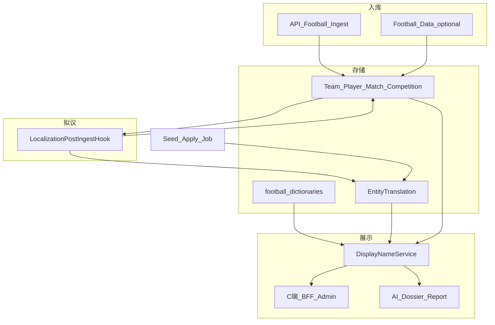

# 全站足球数据中文本地化完整方案 v1

> **版本**：v1  
> **读者**：后端、前端、运维、内容团队  
> **状态**：v1 已落地核心实现（`EntityTranslation`、Hook、字典、DisplayName、Bootstrap zh 步、Admin API）；LLM draft 批量仍为骨架  
> **关联**：[world-cup-af-cutover-v1.1.md](./world-cup-af-cutover-v1.1.md)（AF 专轨）、[world-cup-ops-runbook.md](./world-cup-ops-runbook.md)（运维）  
> **入库挂钩**：[localization-ingest-integration.md](./localization-ingest-integration.md)

---

## 1. 背景与问题

当前数据主要来自：

```text
API-Football（主）
Football-Data（联赛/历史，逐步弱化）
和风天气
手工种子 / 运营 PATCH
AI 生成内容
```

AF 入库字段以英文为主，例如：`Team.name`、`Player.name`、`Match.city`、fixture 裁判字符串、statistics/events 的 `type`、status 短码等。

世界杯 AF 专轨已具备**局部**中文能力：

| 已有能力 | 说明 | 状态 |
|----------|------|------|
| `AfTeamNameOverride` | 国家队 `apiFootballTeamId` → `nameCn` | **已实现** |
| `syncTeamsAfForLeague` | Bootstrap 读取覆盖表写 `Team.nameCn` | **已实现** |
| `wc2026Profile.manual` | 运营富文本、教练/营销字段 | **已实现** |
| `historicalHeritageZh` | 由 AF 统计自动生成中文**段落**（非人名） | **已实现** |
| 球员 `Player.nameCn` | 当前 **`nameCn = nameEn`** | 英文 |
| 裁判 | `nameCn` = 英文 fixture 字符串 | 英文 |

业务目标：

```text
1. 已入库数据可批量中文化
2. 新入库数据自动进入中文化流程
3. 覆盖世界杯 + 五大联赛 + 欧冠等，不限世界杯
4. C 端、后台、AI 报告展示一致中文
```

因此需要从「世界杯局部覆盖」升级为：

> **全站足球数据中文本地化体系**（英文原文保留，中文可审计、可回滚）。

---

## 2. 总体目标

### 2.1 产品目标

用户主界面以中文为主，例如：

```text
阿森纳 vs 曼联 · 英超 · 未开始 · 控球率 · 基利安·姆巴佩
```

而非英文主标题堆叠。

### 2.2 技术目标

```text
历史数据批量中文化（Backfill Job）
新数据入库后自动处理（PostIngestHook）
翻译可审计（draft / approved / locked）
英文原文保留（nameEn、AF 原始 JSON）
C 端统一 displayName
AI dossier / report 使用同一套中文名
后台可查看覆盖率与缺失清单
```

---

## 3. 核心原则

| 原则 | 说明 |
|------|------|
| 英文原文保留 | 便于 AF 对账、排错、重同步 |
| 中文展示优先 | C 端主标题用 `displayName`，不直接绑 `nameEn` |
| 不做实时翻译 | 不在每次 GET 时调翻译 API |
| 人工/种子优先 | 官方译名、运营确认优先于 LLM |
| LLM 只做草稿 | 默认 `draft`，审核后 `approved` |
| 通用翻译表为主 | `EntityTranslation`，避免每类实体一张 override 表失控 |
| 字典类用规则 | 状态、事件、统计项、位置等走静态字典 |
| 入库后自动处理 | AF/FD 写入后触发 localization hook |
| AI 与 C 端一致 | dossier 输入用 `displayName`，禁止模型自行音译队名 |
| 支持缺失运营 | 后台列出无 approved 翻译的实体 |

---

## 4. 本地化对象范围

### 4.1 实体名称类

| 实体 | 示例 | 优先级 |
|------|------|--------|
| 联赛/杯赛 | Premier League → 英超 | P0 |
| 球队 | Manchester United → 曼联 | P0 |
| 国家/地区 | England → 英格兰 | P0 |
| 球员 | Kylian Mbappé → 基利安·姆巴佩 | P1 |
| 教练 | Pep Guardiola → 佩普·瓜迪奥拉 | P1 |
| 裁判 | Michael Oliver → 迈克尔·奥利弗 | P1 |
| 城市 | London → 伦敦 | P1 |
| 场馆 | Wembley Stadium → 温布利球场 | P2 |
| 轮次/阶段 | Group Stage → 小组赛 | P1 |

### 4.2 字典枚举类

| 类型 | 示例 | 优先级 |
|------|------|--------|
| 比赛状态 | NS → 未开始，1H → 上半场 | P0 |
| 事件类型 | Goal → 进球，Yellow Card → 黄牌 | P0 |
| 技术统计 | Ball Possession → 控球率 | P0 |
| 球员位置 | Goalkeeper → 门将 | P0 |
| 赔率市场 | Match Winner → 胜平负 | P2 |
| 阵容角色 | Substitute → 替补 | P0 |

### 4.3 文案与 API

C 端 / 后台列表 / AI dossier / AI report 均走统一 `displayName` 与字典字段（`statusCn`、`typeCn` 等）。

---

## 5. 总体架构



---

## 6. 中文来源优先级与 displayName

翻译来源优先级（高 → 低）：

```text
1. ADMIN_APPROVED   人工后台确认且 locked
2. SEED_APPROVED    种子包 approved
3. LLM_APPROVED     LLM 后人工通过
4. RULE             静态字典
5. entity.nameCn    实体缓存（由 approved 回写）
6. nameEn / name    英文兜底
7. 未知
```

展示规则（**拟议** `DisplayNameService`）：

```ts
displayName =
  approvedTranslation?.translatedText
  ?? ruleDictionary(entityType, sourceText)
  ?? entity.nameCn
  ?? entity.nameEn
  ?? entity.name
  ?? '未知';

translationStatus: 'approved' | 'draft' | 'fallback';
```

### 6.1 实施说明（v1.1 评审增补）

- **列表 API 必须批量 resolve**（按 `teamIds[]` / `playerIds[]` 一次查询），禁止每场 N+1 查 `EntityTranslation`。
- **`nameCn` 缓存建议允许 null**：未翻译时不要用英文填满 `nameCn`，否则覆盖率统计失真；fallback 仅在 `displayName` 层发生。
- **Hook 在 upsert 之后**调用，必须带本地 `entityId` + `externalSource` + `externalId`。
- **裁判**使用 normalized key（小写、去标点、去 `, Country` 后缀），同人共用一条 translation。
- **发布门禁中文**（拟议）：世界杯球队 100% `approved`；球员覆盖率建议先 **warning**，或仅要求首发 11 人，避免永远发不出 AI。

---

## 7. 数据模型（拟议）

### 7.1 EntityTranslation

```prisma
model EntityTranslation {
  id             String   @id @default(cuid())
  entityType     String   // team | player | competition | referee | coach | city | venue | country
  entityId       String?
  externalSource String?  // API_FOOTBALL | FOOTBALL_DATA | DICTIONARY | INTERNAL
  externalId     String?
  locale         String   @default("zh-CN")
  field          String   @default("name")
  sourceText     String?
  translatedText String
  shortText      String?
  aliasJson      Json?
  metadataJson   Json?
  source         String   // admin | seed | llm | rule | import
  status         String   // draft | approved | rejected
  confidence     Float?
  locked         Boolean  @default(false)
  updatedBy      String?
  approvedBy     String?
  approvedAt     DateTime?
  createdAt      DateTime @default(now())
  updatedAt      DateTime @updatedAt

  @@unique([entityType, externalSource, externalId, locale, field])
  @@index([entityType, entityId])
  @@index([status, source])
}
```

**权威记录**在 `EntityTranslation`；`Team.nameCn` / `Player.nameCn` 等为 **approved 回写缓存**，列表接口优先读实体表。

### 7.2 实体表字段（逐步 migration）

| 模型 | 建议字段 |
|------|----------|
| Team | `nameEn`, `nameCn?`, `shortNameCn?` |
| Player | `nameEn`, `nameCn?`, `shortNameCn?` |
| Competition | `nameEn`, `nameCn?`, `shortNameCn?` |
| Match | `city?`, `cityCn?`, `venueName?`, `venueNameCn?` |

### 7.3 AfTeamNameOverride 迁移

| 阶段 | 行为 |
|------|------|
| 短期 | **保留**现有表与 [WorldCupTeamsPage](../admin-web/src/pages/world-cup/WorldCupTeamsPage.tsx) UI |
| 中期 | Job：`AfTeamNameOverride` → `EntityTranslation`（`source=import`, `status=approved`） |
| 长期 | 读取统一走 `EntityTranslation` / `DisplayNameService`，废弃 override 表 |

---

## 8. 种子包与字典

### 8.1 目录结构（拟议）

```text
data/localization/zh-CN/
├── competitions.json
├── teams.popular.json
├── teams.worldcup2026.json
├── players.popular.json
├── players.worldcup2026.json
├── countries.json
├── cities.json
├── venues.worldcup2026.json
├── referees.json
├── coaches.json
└── football-dictionaries.json
```

### 8.2 种子条目示例

**联赛**（`competitions.json`）：

```json
{
  "externalSource": "API_FOOTBALL",
  "externalId": "39",
  "nameEn": "Premier League",
  "nameCn": "英超",
  "shortNameCn": "英超"
}
```

**球队**（`teams.popular.json`）：

```json
{
  "externalSource": "API_FOOTBALL",
  "externalId": "33",
  "nameEn": "Manchester United",
  "nameCn": "曼联",
  "shortNameCn": "曼联",
  "aliases": ["曼彻斯特联"]
}
```

**球员**（`players.popular.json`）：

```json
{
  "externalSource": "API_FOOTBALL",
  "externalId": "278",
  "nameEn": "Kylian Mbappé",
  "nameCn": "基利安·姆巴佩",
  "shortNameCn": "姆巴佩"
}
```

### 8.3 静态字典（`football-dictionaries.json`）

覆盖 `matchStatus`、`positions`、`events`、`statistics`、`oddsMarkets` 等键值；由 `FootballDictionaryService` 在组装 live/intel/phase 响应时附加 `*Cn` 字段。

示例：

```json
{
  "matchStatus": { "NS": "未开始", "1H": "上半场", "FT": "已结束", "LIVE": "进行中" },
  "statistics": { "Ball Possession": "控球率", "Shots on Goal": "射正" },
  "events": { "Goal": "进球", "Yellow Card": "黄牌", "subst": "换人" }
}
```

完整键表在实现 `football-dictionaries.json` 时按 AF 实际返回值扩充。

---

## 9. 服务设计（拟议）

### 9.1 LocalizationService

路径：`src/localization/localization.service.ts`

职责：查询/写入翻译、回写实体、`getMissingTranslations`、`getCoverage`。

### 9.2 DisplayNameService

路径：`src/localization/display-name.service.ts`

职责：对 C 端 / dossier / 榜单提供 `team()` / `player()` / `competition()` / `matchVenue()` 及 **批量** `teamsByIds()`。

### 9.3 LocalizationPostIngestHook

路径：`src/localization/localization-post-ingest.hook.ts`

在 AF 写入后调用：

```text
onCompetitionUpsert
onTeamUpsert
onPlayerUpsert
onMatchUpsert
onRefereeSeen
onCoachSeen
```

规则：

```text
有 approved 且非 locked → 回写 nameCn / shortNameCn
无 approved → 不覆盖；可选写入 draft 队列
禁止覆盖 locked=true 的 admin 记录
```

挂钩文件见 [localization-ingest-integration.md](./localization-ingest-integration.md)。

---

## 10. 历史数据回填

### 10.1 Job：`localization_backfill_all`

参数示例：

```ts
{
  entityTypes?: ('competition' | 'team' | 'player' | 'coach' | 'referee' | 'venue' | 'city')[];
  competitionCodes?: string[];
  onlyMissing?: boolean;
  applyDraft?: boolean;
  dryRun?: boolean;
}
```

步骤：扫描实体 → 应用种子 → 应用字典 → 写 `EntityTranslation` → 回写实体 → 输出覆盖率。

---

## 11. 新入库自动中文化

| 场景 | 触发点 | 处理 |
|------|--------|------|
| 球队 | `upsertTeamFromAf` / `syncTeamsAfForLeague` 后 | hook + 种子 |
| 球员 | `syncSquads` 后 | hook + 种子 |
| 比赛 | fixture upsert 后 | city/venue/referee/status |
| 单场 sync-full | `syncSingleMatchFull` 后 | 字典 + 教练/裁判 |
| 联赛 Cron | `syncPreMatchWindow` 等 | 同 hook |

---

## 12. C 端 API 返回规范（拟议）

**球队**：

```ts
{
  id: string;
  nameEn: string;
  nameCn?: string | null;
  shortNameCn?: string | null;
  displayName: string;
  logoUrl?: string | null;
  translationStatus: 'approved' | 'draft' | 'fallback';
}
```

**比赛**：`competition` / `homeTeam` / `awayTeam` 含 `displayName`；`statusCn`；`cityCn` / `venueNameCn`。

**统计/事件**：`type` + `typeCn`，`detail` + `detailCn`。

**禁止**：前端用 `nameCn || name` 或直接用 `nameEn` 作主标题；后端应返回 `displayName`。

---

## 13. AI 报告本地化

### 13.1 MatchLlmDossier

输入 layers 使用 `displayName`、`statusCn`、字典中文化字段；Prompt 明确：

```text
必须使用输入中的中文 displayName；无中文时保留英文，禁止自行编造译名。
```

涉及文件：[match-llm-dossier.service.ts](../src/match-llm-dossier/match-llm-dossier.service.ts)、[match-llm-bundle-input.service.ts](../src/match-af-raw-bundle/match-llm-bundle-input.service.ts)。

### 13.2 translationHash（拟议）

`intelContentHash` / `inputHash` 之外，可增加 `translationHash`（approved 翻译批次或 max(updatedAt)），翻译变更后触发 AI 草稿 stale 或强制 regenerate。

---

## 14. 后台本地化管理（拟议）

菜单：

```text
本地化管理
├── 翻译总览（覆盖率）
├── 联赛/球队/球员
├── 教练/裁判
├── 足球字典
└── 待审核翻译
```

Admin API（拟议前缀 `/admin/api/localization`）：

| 方法 | 路径 | 说明 |
|------|------|------|
| GET | `/overview` | 覆盖率 |
| GET | `/translations` | 列表筛选 |
| POST | `/translations` | 新增/修改 |
| POST | `/translations/:id/approve` | 审核 |
| POST | `/translations/:id/reject` | 拒绝 |
| POST | `/seed/apply` | 导入种子 |
| POST | `/backfill` | 历史回填 → `jobId` |
| POST | `/llm-draft` | 批量 LLM 草稿 → `jobId` |

操作写 `AuditLog`：`wc_zh_translation_*` 等 action。

---

## 15. 与世界杯模块衔接

世界杯不再维护独立中文机制，统一走本方案。

### 15.1 Bootstrap 拟议新增步骤

在 [world-cup-bootstrap.service.ts](../src/world-cup/world-cup-bootstrap.service.ts) 的 `STEPS` 中，`team_profiles_wc` 之后、`matches_ai_draft` 之前：

```text
zh_seed_apply              # 导入 data/localization/zh-CN/*.json
localization_backfill_wc # 仅 WC 范围回填 + 回写
zh_coverage_report         # 中文覆盖率摘要（可选）
```

推荐顺序：

```text
fixtures_wc → teams_af → squads_wc → standings_wc → leaderboards_wc → team_profiles_wc
→ zh_seed_apply → localization_backfill_wc
→ matches_sync_full → … → matches_ai_draft → coverage_report
```

### 15.2 发布门禁（拟议）

在现有 `WC_AI_PUBLISH_GATE_FAILED` 之外，可增加 warning 级 `WC_ZH_COVERAGE_LOW`（不阻断或仅阻断发布，产品定）。

---

## 16. 与普通联赛同步衔接

以下路径在写入后均应调用同一 `LocalizationPostIngestHook`（不仅世界杯）：

- [api-football-ingest.service.ts](../src/api-football/api-football-ingest.service.ts)（fixtures、squads）
- [af-sync-orchestrator.service.ts](../src/api-football/af-sync-orchestrator.service.ts)
- [ingest-orchestrator.service.ts](../src/data-pipeline/ingest-orchestrator.service.ts) 各 bundle step

---

## 17. 搜索（P2）

索引或搜索 API 支持：`nameCn`、`nameEn`、`shortNameCn`、`aliasJson`（如「曼联」「曼彻斯特联」「Manchester United」）。

---

## 18. LLM 翻译策略

- 仅产出 `status=draft`，`source=llm`
- 不覆盖 `locked` 或已有 `approved`
- 每日限额 / 按 `competitionCode` 分批
- Prompt 要求大陆常用足球译名，不确定返回 null

---

## 19. 风险与规避

| 风险 | 规避 |
|------|------|
| 译名不准 | 种子/人工优先 |
| 同名球员 | 以 AF player id 为键 |
| 新数据又变英文 | PostIngestHook |
| C 端字段混乱 | 强制 displayName |
| AI 中英混杂 | dossier 用 displayName |
| 覆盖人工译名 | locked=true |
| 性能 | 实体缓存 + 批量查询 |

---

## 20. 实施分期

### P0a — 快速见效（1～2 周，可与 P0b 并行）

```text
football-dictionaries.json + FootballDictionaryService
competitions / 热门 teams 种子（文件或 DB）
DisplayNameService 最小实现（team/competition）
C 端比赛列表/详情/intel/phase/live 接 displayName + statusCn/typeCn
```

验收：五大联赛+欧冠+世界杯**名称**中文；状态/统计/事件中文；不要求全量球员。

### P0b — 体系化（2～4 周）

```text
EntityTranslation 表 + migration
LocalizationPostIngestHook
Seed Apply Job + Backfill Job
AfTeamNameOverride 导入
Admin Localization API 骨架
世界杯 Bootstrap 新增 zh 步骤
```

### P1 — 人名类

球员/教练/裁判种子、后台审核、LLM draft、射手榜/阵容 displayName、世界杯球员覆盖率 ≥80%（运营目标）。

### P2 — 长尾

城市/场馆、赔率市场、搜索别名、CSV 导入导出、覆盖率监控大盘。

---

## 21. 后端交付清单（全量）

```text
1. Prisma：EntityTranslation + 可选 cityCn/venueNameCn/shortNameCn
2. data/localization/zh-CN/*
3. football-dictionaries
4. LocalizationModule（Service + Hook + DisplayName + Dictionary）
5. Seed Apply / Backfill / LLM draft Jobs
6. Admin Localization API + AuditLog
7. C 端/BFF displayName 改造
8. AI dossier + translationHash
9. 单元测试：resolveDisplayName、字典、hook 不覆盖 locked
10. 文档：本文 + ingest-integration
```

---

## 22. QA 验收清单

- [x] 英超/西甲/意甲/德甲/法甲/欧冠/世界杯 `displayName` 为中文（有种子部分）
- [x] 比赛状态、事件 type、统计 type 有 `*Cn`
- [x] 人工 approved 后 AF 重同步不覆盖（locked）（单测 `applySeedEntry` / hook）
- [x] 无翻译实体 fallback 英文且进入缺失列表（`GET .../translations/missing`）
- [x] AI 报告主客队名为中文 displayName（dossier/bundle/intel）
- [x] 后台可看覆盖率、可审核、可 seed/backfill/llm-draft（`/localization` 页）
- [x] 世界杯 Bootstrap 在 AI draft 前完成 zh_seed_apply

---

## 23. 一句话总结

> 本地化不是给世界杯补几个中文名，而是建设全站「英文入库 + 中文显示层」：`EntityTranslation` + 字典 + `displayName` + 入库 Hook + 种子/回填/后台；英文保留，中文可审，世界杯与联赛共用一套机制。

---

## 附录：与入库链路挂钩

详见 [localization-ingest-integration.md](./localization-ingest-integration.md)。
