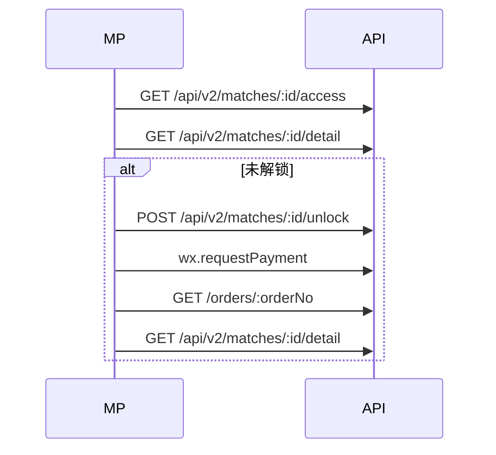

# 小程序前端对接文档（完整版）

> **版本**：2026-05-20 · API v2 主路径  
> **读者**：微信小程序  
> **Base**：`{API_ORIGIN}`（示例：`https://oaifjhzmpswi.sealosbja.site`）  
> **Web 文档**：[Web前端对接文档-完整版.md](./Web前端对接文档-完整版.md)  
> **路由母本**：[API接口对接文档-完整版.md](./API接口对接文档-完整版.md)

**修订说明（2026-05-20）**：绿库与 AI **PUBLISHED** 可见性、`paidModules.aiReports` 三态、Deprecated 四接口、**`GET /rankings/leaderboards`**、下单发布前置、赛中**轮询**专章。行为细节以母本 §2.4–§2.5.3 为准。

---

## 0. 阅读指引

| § | 内容 |
|---|------|
| 1 | 环境与小程序须知 |
| 2 | 统一响应 |
| 3 | wx.login / 绑手机 |
| 4 | C 端 API 全量清单 |
| 5 | API v2（含 §5.3 绿库与 AI 发布） |
| 6 | match-detail-v2 |
| 7 | 订单与支付 |
| 8 | me 域 |
| 9 | 联赛 / B4 |
| 10 | 赛中轮询 |
| 11 | 页面序列 |
| 12 | 联调 |

**已合并**：[第一期前端对接规范文档.md](./第一期前端对接规范文档.md) §1–2；[Web比赛详情对接说明.md](./Web比赛详情对接说明.md) → §6；[登录注册对接说明.md](./登录注册对接说明.md) → §3。

---

## 1. 环境与小程序开发者须知

### 1.1 Base URL

- `{API_ORIGIN}/路径`，**无**全局 `/api` 前缀（**除** `/api/v2/...`）。
- Swagger：`{API_ORIGIN}/docs`（生产需 `ENABLE_SWAGGER_DOCS=true`）。
- 前端域须配置 **request 合法域名**（示例 `https://oovxhxiusmdy.sealosbja.site`）。

### 1.2 Web 与小程序差异

| 主题 | Web | 小程序 |
|------|-----|--------|
| 登录 | 微信扫码 OAuth、邮箱密码 | `wx.login` |
| Token | `localStorage` | `wx.storage` |
| 支付 | JSAPI（需 openid） | `wx.requestPayment` |
| 赛中 | **SSE** | 轮询 |
| 详情 | `GET /api/v2/matches/:id/detail` | 同左 |

### 1.3 禁止

- `/admin/*`、`/admin/api/*`；浏览器直连 `/football-feed/*`。
- 自造 `matchId`（须 cuid）。

---

## 2. 统一响应与错误处理

成功：`{ "success": true, "data": {}, "message": "ok" }`  
错误：`{ "success": false, "message": "...", "errorCode": "..." }`

业务数据在 **`body.data`**（`success === true` 时）。完整 `request` 封装见 §3.2。

---

## 3. 鉴权与用户（小程序）

### 3.1 合法域名

微信公众平台 → 开发 → 开发管理 → 开发设置 → **服务器域名** → request 合法域名填 `{API_ORIGIN}` 的**主机名**（不含路径）。

### 3.2 wx.request 封装

```typescript
const apiOrigin = getApp().globalData.apiOrigin; // 如 https://oaifjhzmpswi.sealosbja.site

function request<T>(options: WechatMiniprogram.RequestOption): Promise<T> {
  const token = wx.getStorageSync('accessToken');
  return new Promise((resolve, reject) => {
    wx.request({
      ...options,
      url: `${apiOrigin}${options.url}`,
      header: {
        'Content-Type': 'application/json',
        ...(token ? { Authorization: `Bearer ${token}` } : {}),
        ...options.header,
      },
      success(res) {
        const body = res.data as { success?: boolean; data?: T; message?: string };
        if (res.statusCode >= 400 || body.success === false) {
          reject(new Error(body.message || String(res.statusCode)));
          return;
        }
        resolve((body.data ?? body) as T);
      },
      fail: reject,
    });
  });
}
```

### 3.3 wx.login + wechat-login

```typescript
async function wechatLogin() {
  const { code } = await new Promise<WechatMiniprogram.LoginSuccessCallbackResult>(
    (resolve, reject) => wx.login({ success: resolve, fail: reject }),
  );
  const data = await request<{ accessToken: string }>({
    url: '/auth/wechat-login',
    method: 'POST',
    data: { code },
  });
  wx.setStorageSync('accessToken', data.accessToken);
  return data;
}
```

### 3.4 绑定手机

同 Web：`send-code` → `bind-phone`；403 `PHONE_VERIFICATION_REQUIRED` 时引导绑手机。

### 3.5 可选 Bearer

详情 `GET /api/v2/matches/:id/detail` 建议始终带 Token（若已登录）。

---

## 4. C 端 API 全量清单

### 4.1 公开（无需 JWT）

| METHOD | 路径 | Query / Body 摘要 |
|--------|------|---------------------|
| GET | `/health` | `?db=1` 或 `?db=true` 时附带数据库探测 |
| GET | `/tournaments` | `type?`（`TournamentType` 枚举）, `isActive?`（`true`/`false` 字符串） |
| GET | `/tournaments/:code` | — |
| GET | `/tournaments/:code/competitions` | — |
| GET | `/tournaments/:code/matches` | — |
| GET | `/tournaments/:code/standings` | `group?`（与 `Match.groupName` 一致，如小组赛 `A`） |
| GET | `/seasons` | — |
| GET | `/seasons/:id` | — |
| GET | `/competitions` | `tournamentId?`, `seasonId?` |
| GET | `/competitions/match-counts` | `from?`, `to?`（ISO）, `status?`, `tournamentId?`, `seasonId?`；按 `competitionId` 聚合 `matchCount`（侧边栏联赛计数） |
| GET | `/competitions/:id/worldcup2026-schedule/:teamId` | 须在泛化 `:id` 之前注册（源码已排序） |
| GET | `/competitions/:id/worldcup2026-teams/:teamId` | `slim?` = `1` / `true` 精简 |
| GET | `/competitions/:id/worldcup2026-teams` | `slim?` |
| GET | `/competitions/:id/standings` | `group?`（由已完赛场次聚合积分） |
| GET | `/leagues/standings` | `codes?`（默认 PL,PD,SA,BL1,FL1,CL,EL）、`season?`（默认 2025）、`source?`（`auto` \| `db` \| `api_football`） |
| GET | `/leagues/:code/standings` | `season?`, `source?`；BFF 规范化 api-sports 积分榜 |
| GET | `/competitions/:id` | — |
| GET | `/matches` | `tournamentId?`, `competitionId?`, `seasonId?`, `status?`；**无分页**；含 `liveStatusSyncHint`（见第二期规范 §4.5） |
| GET | `/matches/:matchId/detail-v2` | 可选 Bearer；**Deprecated 头**；新接入用 **`/api/v2/.../detail`** |
| GET | `/matches/:id/intel` | 可选 Bearer；**Deprecated（90 天）** |
| GET | `/matches/:id/analysis-preview` | 可选 Bearer；**Deprecated（90 天）** |
| GET | `/matches/:id/pre-match` | 可选 Bearer；**Deprecated（90 天）**；见 §4.4 |
| GET | `/matches/:id/live` | 可选 Bearer；赛中（**非 Deprecated**） |
| GET | `/matches/:id/post-match` | 可选 Bearer；仅 **`FINISHED`**；**Deprecated（90 天）** |
| GET | `/matches/:id/live/stream` | **SSE** `text/event-stream`；Query `lastSeq?`；限流约 **30 次/分钟/IP**；网关需 `X-Accel-Buffering: no`、读超时 **≥120s** |
| GET | `/matches/:id/odds-snapshots` | 赔率快照 T24/T1/LIVE + disclaimer；**非投注建议** |
| GET | `/matches/:id/injuries` | 本场伤停 BFF（勿浏览器直连 `/football-feed/injuries`）；需 `externalId` 为 `af-f-*` |
| GET | `/matches/:id` | 可选 Bearer；详情与解锁态 |
| GET | `/leagues/:code/injuries` | `season?`, `teamId?`（AF 联赛伤停，服务端代理） |
| GET | `/rankings/players` | `metric=powerRating` → **410** |
| GET | `/rankings/leaderboards` | `codes?`、`season?`（默认 **2025**）、`wcSeason?`（默认 **2026**）；见 §9 |
| GET | `/players/:id/summary` | 球员公开摘要；含 `marketValue`、`seasonStats`、`radarHints` |
| GET | `/teams/:teamId/upcoming-schedule` | `days?`（默认 30）；未来赛程 + `difficulty` / `difficultyScore` |
| GET | `/insights/upset-signals` | `from?`, `to?`, `limit?`, `minUpset?`（ISO 时间；默认近/后各约 14 天） |
| GET | `/insights/champion-prediction` | `competitionId`（如 `seed-comp-wc`）；启发式冠军预测，`available: false` 时含 `reason` |
| GET | `/cms/tools` | 工具入口配置（内置默认列表） |
| GET | `/cms/materials` | `category?` |
| GET | `/cms/reports` | `category?`, `type?`（`match` \| `season` \| `team` \| `player`）；报告发现页样例列表（`config/cms-reports.json`） |
| GET | `/cms/membership-plans` | 与 `GET /orders/pricing` 同 payload（含 **`features`** 权益表） |
| GET | `/orders/pricing` | **V2 价目** + **`features: { free, pro }`**（`config/pricing-features.json` 或 `PRICING_FEATURES_JSON`） |
| GET | `/auth/captcha` | `provider: svg` → `{ captchaId, imageBase64 }`；`provider: geetest` → 极验 init 字段 |
| POST | `/auth/register` | 至少 `email`/`username` 之一 + `password` + `captchaId`；SVG 用 `captchaCode`，Geetest 用 `lotNumber`/`captchaOutput`/`passToken`/`genTime` |
| POST | `/auth/login` | `{ "identifier", "password" }`（邮箱或用户名） |
| GET | `/auth/wechat/web/authorize` | Web 扫码；`?json=1` 返回 `{ url, state }`，否则 302 |
| GET | `/auth/wechat/web/callback` | 微信 OAuth 回调 → 302 到 `AUTH_WEB_FRONTEND_CALLBACK?accessToken=` |
| POST | `/auth/apple/login` | `{ "idToken" }` |
| POST | `/auth/bind-apple` | 已登录绑定 Apple |
| GET | `/auth/google/authorize` | Google Web 扫码；`?json=1` 返回 `{ url, state }` |
| GET | `/auth/google/callback` | Google OAuth 回调 → 302 带 `accessToken` |
| POST | `/auth/google/login` | Google `id_token` 登录 |
| POST | `/auth/bind-google` | 已登录绑定 Google |
| POST | `/auth/wechat-login` | 小程序 `{ "code", "nickname?", "avatarUrl?" }` |
| POST | `/auth/phone/send-code` | `{ "phone", "purpose?" }`：`bind` \| `reset_password`（**无 register**） |
| POST | `/auth/phone/register` | **[默认关闭]** 手机验证码注册 |
| POST | `/auth/phone/login-password` | `{ "phone", "password" }`（历史账号） |
| POST | `/auth/phone/login-otp` | **[默认关闭]** 手机验证码登录 |
| POST | `/auth/password/forgot-phone` | 找回密码发码 |
| POST | `/auth/password/reset-phone` | `{ "phone", "code", "newPassword" }` |
| POST | `/wxpay/notify` | 微信回调；原始 body 验签 |
| POST | `/feedback` | `{ "message", "contact?" }`；可选 Bearer 写入 `userId`（匿名亦可） |
| GET | `/football-feed/*` | 上游 api-sports 代理；Query 见 **§4** 与 Swagger |

### 4.2 需 JWT（登录用户）

| METHOD | 路径 | 说明 |
|--------|------|------|
| GET | `/matches/:id/unlock-status` | 当前用户本场是否视为已解锁 |
| POST | `/orders/matches/:matchId/create` | 同 **`POST /api/v2/matches/:matchId/unlock`**；见 §7 |
| POST | `/orders/membership/create` | Body：`{ "plan": "month" \| "quarter" \| "year" }` |
| POST | `/orders/social-poster/matches/:matchId/create` | 社交海报付费订单 |
| GET | `/orders/:orderNo` | 当前用户订单详情 |
| POST | `/matches/:id/social-poster/generate` | 海报出图；Body 可选 `{ "customElements?" }`；响应含 `status`、`posterImageUrl`、`billing`、`orderNo?`（见 **§2.3**） |
| POST | `/auth/bind-phone` | `{ "phone", "code" }` |
| POST | `/auth/bind-wechat` | `{ "code", "nickname?", "avatarUrl?" }` |
| PATCH | `/auth/password` | `newPassword`；已设密码时需 `currentPassword` |
| PATCH | `/auth/profile` | 可选 `nickname`, `avatarUrl` |
| GET | `/auth/me` | 当前用户公开字段 |
| GET | `/worldcup2026/me/team-follows` | 关注列表 |
| POST | `/worldcup2026/me/team-follows` | Body：`{ "teamId" }` |
| DELETE | `/worldcup2026/me/team-follows/:teamId` | 取消关注 |
| GET | `/worldcup2026/me/team-follows/:teamId/status` | 是否已关注 |
| GET | `/me/favorite-matches` | 收藏比赛列表（含 `match` 摘要） |
| POST | `/me/favorite-matches` | Body：`{ "matchId" }` |
| DELETE | `/me/favorite-matches/:matchId` | 取消收藏 |
| GET | `/me/match-reminders` | 提醒列表 |
| POST | `/me/match-reminders` | `matchId`, `notifyOffsetMinutes?`, `channel?` |
| PATCH | `/me/match-reminders/:id` | `notifyOffsetMinutes?`, `channel?`, `active?` |
| DELETE | `/me/match-reminders/:id` | — |
| GET | `/me/preferences` | `{ "data": { ... } }` |
| PATCH | `/me/preferences` | 顶层 key 浅合并进 `data` |
| GET | `/me/social-posters` | `cursor?`（上一页最后 `orderNo`）, `limit?`；列表项含 `imageUrl`、`template`、`matchId` |
| GET | `/me/report-unlocks` | 已购报告列表；含 `title`、`unlockedAt`、`reportStatus`、`freeSummary`（非全文） |
| GET | `/me/orders` | `product?`（`OrderProduct` 枚举名）, `cursor?`, `limit?` |
| GET | `/me/browse-history` | `cursor?`（上一项 `id`）, `limit?`；跨设备浏览记录 |
| POST | `/me/browse-history` | Body：`type`（`analysis`\|`poster`\|`view`）, `matchId?`, `title?`, `sub?`, `visitedAt?`；同场同类型 upsert |
| GET | `/me/notifications` | `cursor?`, `limit?`, `unreadOnly?`；**消息中心**（非开球提醒） |
| PATCH | `/me/notifications/:id` | Body：`{ "read": true }` |
| POST | `/me/notifications/read-all` | 全部标已读 |

### 4.4 三页合同（`match-phase-v1`）

**新详情**以 **`GET /api/v2/matches/:id/detail`** 为主；`pre-match`/`post-match` **Deprecated（90 天）**；赛中 **`live`** 仍用轮询（§10）。

| 路径 | 适用状态 | 说明 |
|------|----------|------|
| `GET /matches/:id/pre-match` | 赛前 | **Deprecated**；`narrative` 仅 **PUBLISHED** |
| `GET /matches/:id/live` | 赛中 | **非 Deprecated**；轮询主接口 |
| `GET /matches/:id/post-match` | **`FINISHED`** | **Deprecated** |
| `GET /matches/:id/live/stream` | 赛中 | SSE（小程序**不推荐**，见 §10） |

#### narrative 与报告状态

| 观众 | 规则 |
|------|------|
| 普通用户 | **仅** `PUBLISHED` |
| ADMIN JWT | DRAFT/REVIEW 预览（勿作线上默认） |
| 未解锁 | `freeSummary` 截断 |
| 已解锁 | 全文 / `structuredSummary` |

`model.predictionMarkets` 恒 `null`；原 `ui` 合成块已下线。列表：`GET /matches`；盘口：`odds-snapshots`。

---

## 5. API v2 专章

### 5.1 API v2 路由全表

| METHOD | 路径 | 鉴权 | Query / Body | data 要点 | 前端注意 |
|--------|------|------|--------------|-----------|----------|
| GET | `/api/v2/matches/:matchId/detail` | 公开，可选 Bearer | — | `schema: match-detail-v2` | **详情主接口** |
| GET | `/api/v2/matches/:matchId/access` | 公开，可选 Bearer | — | `schema: match-access-v1` | 首屏轻量 |
| POST | `/api/v2/matches/:matchId/unlock` | JWT + 已绑手机 | — | 同 `POST /orders/matches/:matchId/create` | 解锁下单 |
| GET | `/api/v2/leagues/:code/standings` | 公开 | `season?` | 积分榜 | 未 sync → 404 |
| GET | `/api/v2/leagues/:code/topscorers` | 公开 | `season?` | 射手榜 | 同上 |
| GET | `/api/v2/leagues/:code/topassists` | 公开 | `season?` | 助攻榜 | 同上 |
| GET | `/api/v2/leagues/:code/topyellowcards` | 公开 | `season?` | 黄牌榜 | 同上 |
| GET | `/api/v2/leagues/:code/topredcards` | 公开 | `season?` | 红牌榜 | 同上 |
| GET | `/api/v2/leagues/:code/rounds` | 公开 | `season?` | 轮次 | 同上 |
| GET | `/api/v2/teams/:teamId/transfers` | 公开 | `season?` | 转会 | **不进 detail** |
| GET | `/api/v2/teams/:teamId/trophies` | 公开 | — | 荣誉 | 404=未同步 |
| GET | `/api/v2/players/:playerId/trophies` | 公开 | — | 球员荣誉 | 同上 |
| GET | `/api/v2/players/:playerId/sidelined` | 公开 | — | 缺阵史 | 同上 |
| GET | `/matches/:matchId/detail-v2` | 公开，可选 Bearer | — | 同 v2 detail | `Deprecation` + `Link` |

### 5.2 Legacy

新接入只用 `/api/v2/matches/:id/detail`；`detail-v2` 业务体等价。

### 5.3 绿库、AI 发布与 C 端可见性

| 主题 | 前端须知 |
|------|----------|
| 绿库 | `af-f-*` 场次访问 detail 可能触发服务端 sync；看 `availability` |
| AI 可见 | C 端 **只认 PUBLISHED** |
| `aiReports` | 见 §6.5；`hasData` ≠ 已解锁 |
| 三页 `narrative` | 见 §4.4 |
| 下单 | 无 PUBLISHED → **400**；见 §7 |
| 运维 | 后台发布报告 + AF 灌数（不列 admin API） |

---

## 6. 比赛详情契约 `match-detail-v2`

### 6.1 顶层字段

| 字段 | 类型 | 说明 |
|------|------|------|
| `schema` | `"match-detail-v2"` | 固定 |
| `matchId` | string | cuid |
| `fixtureId` | number \| null | AF fixture id |
| `status` | `SCHEDULED` \| `LIVE` \| `FINISHED` 等 | 比赛状态 |
| `serverTime` | ISO string | 服务端时间 |
| `isUnlocked` | boolean | 当前 viewer 是否视为已解锁 |
| `access` | `MatchAccess` | 权限矩阵，见下 |
| `basic` | object | 比分、主客队、赛事、开球时间等 |
| `freeModules` | object | 免费模块 |
| `paidModules` | object | 付费模块（含 locked） |
| `availability` | object | AF bundle 各端点覆盖状态 |
| `paywall` | object | 解锁价、文案、权益列表 |
| `updatedAt` | object | bundle 等更新时间 |

### MatchAccess.permissions（节选）

| 权限键 | 未解锁 SCHEDULED | 已解锁/会员 |
|--------|------------------|-------------|
| `injuries` | true | true |
| `lineups` | true | true |
| `predictions` | false | true |
| `odds` | false | true |
| `aiReports` | false | true |
| `tacticalScript` | false | true |
| `playerIntelligence` | false | true |

完赛且 `FINISHED_FREE_ALL=true`：登录用户可视为已解锁（见服务端配置）。

### paidModules 单项（PaidModuleDto）

```typescript
type PaidModuleDto = {
  locked: boolean;       // true 时 data 必为 null
  available: boolean;    // 库内是否有数据（非 missing）
  hasData?: boolean;
  status?: 'present' | 'empty' | 'missing';
  title: string;
  description?: string;
  source?: 'api-football' | 'deepseek';
  data?: unknown | null;
};
```

### paidModules.odds.data（仅 locked=false 且 hasData 时）

```typescript
type OddsModuleData = {
  latest: unknown;  // bundle.oddsLatestJson
  prematchSnapshots: Array<{
    phase: 'T24' | 'T1';
    capturedAt: string;
    markets: unknown;
  }>;
  liveSnapshots: Array<{
    capturedAt: string;
    markets: unknown;
  }>;
  disclaimer: string;  // 非投注建议文案
};
```

### match-access-v1（GET /api/v2/matches/:id/access）

```json
{
  "schema": "match-access-v1",
  "matchId": "cmpbfd6f901lap201oypcx4se",
  "serverTime": "2026-05-19T12:00:00.000Z",
  "isUnlocked": false,
  "access": { "...": "同 detail.access" },
  "paywall": {
    "unlockType": "single_match",
    "unlockPrice": { "amountCents": 690, "currency": "CNY", "display": "¥6.90" },
    "price": 690,
    "currency": "CNY"
  }
}
```

### 游客 detail 节选

```json
{
  "schema": "match-detail-v2",
  "isUnlocked": false,
  "paidModules": {
    "predictions": { "locked": true, "hasData": true, "data": null },
    "odds": { "locked": true, "hasData": true, "data": null }
  },
  "freeModules": {
    "injuries": { "available": true, "data": [{ "type": "Missing", "reason": "..." }] }
  }
}
```


### 6.7 已解锁 detail 节选

```json
{
  "schema": "match-detail-v2",
  "isUnlocked": true,
  "paidModules": {
    "odds": {
      "locked": false,
      "hasData": true,
      "data": {
        "latest": {},
        "prematchSnapshots": [{ "phase": "T24", "capturedAt": "2026-05-18T10:00:00.000Z", "markets": {} }],
        "liveSnapshots": [{ "capturedAt": "2026-05-18T20:15:00.000Z", "markets": {} }],
        "disclaimer": "数据仅供参考，不构成投注建议。"
      }
    }
  }
}
```

### 6.8 TypeScript 类型草案

```typescript
export interface PaidModuleDto {
  locked: boolean;
  available: boolean;
  hasData?: boolean;
  status?: 'present' | 'empty' | 'missing';
  title: string;
  data?: unknown | null;
}

export interface MatchDetailV2 {
  schema: 'match-detail-v2';
  matchId: string;
  fixtureId: number | null;
  status: string;
  serverTime: string;
  isUnlocked: boolean;
  access: Record<string, unknown>;
  basic: Record<string, unknown>;
  freeModules: Record<string, PaidModuleDto>;
  paidModules: {
    predictions: PaidModuleDto;
    odds: PaidModuleDto;
    aiReports: PaidModuleDto;
    tacticalScript: PaidModuleDto;
    playerIntelligence: PaidModuleDto;
  };
  paywall: Record<string, unknown>;
}
```

### 6.2 Redis 缓存 tier

键：`match-detail-v2:{matchId}:{tier}`。**禁止** guest/free 命中 unlocked 缓存（`guest` / `free` / `unlocked` / `admin`）。

### 6.3 环境变量（服务端）

`ENABLE_AF_RAW_BUNDLE`（默认 true）、`ENABLE_OLS`/`ENABLE_PREDICTION_MARKETS`（默认 false）、`FINISHED_FREE_ALL`（默认 true）。详见母本 §2.5.1。

### 6.4 已下线模块

`predictionMarkets`、OLS、`match-detail-pre-unlocked` UI；Deprecated：`intel`、`pre-match`、`post-match`、`analysis-preview`（**不含** `live`）。

### 6.5 `paidModules.aiReports`

仅 **`PRE_MATCH` + `PUBLISHED`**；`hasData` 表示有已发布报告；**`data` 仅解锁后为数组**，否则 `null`。

```json
"aiReports": { "locked": true, "hasData": true, "data": null }
```

已解锁：`"data": [{ "id", "reportType", "freeSummary", "source": "deepseek" }]`。

### 6.6 迁移

| 旧 | 新 |
|----|-----|
| intel + pre-match + analysis-preview | `GET /api/v2/.../detail` |
| 赛中 | `GET .../live` 轮询（§10） |

---

## 7. 订单与支付（小程序）

| 方法 | 路径 |
|------|------|
| POST | `/api/v2/matches/:matchId/unlock` |
| GET | `/orders/:orderNo` |

```typescript
const created = await request({
  url: `/api/v2/matches/${matchId}/unlock`,
  method: 'POST',
});
if (created.payParams) {
  await new Promise<void>((resolve, reject) => {
    wx.requestPayment({ ...created.payParams, success: () => resolve(), fail: reject });
  });
}
// payParams 字段以 GET /orders/:orderNo 为准：timeStamp, nonceStr, package, signType, paySign
```

### 7.1 下单前置

| 条件 | 结果 |
|------|------|
| `FINISHED` | `isUnlocked: true`，无需下单 |
| 无 PUBLISHED 报告 | **400** `报告尚未发布，暂不可购买解锁` |
| 已解锁 | 无新单 |

`AUTH_REQUIRE_VERIFIED_PHONE=true` 时须 **`POST /auth/bind-phone`**。手机注册用户须 **`POST /auth/bind-wechat`** 获取 `openid` 后 `wx.requestPayment`。

---

## 8. 用户中心 `me` 域

见 §4.2：`/me/favorite-matches`、`/me/match-reminders`、`/me/preferences`、`/me/report-unlocks`、`/me/browse-history`、`/me/notifications` 等。  
**勿混用** `match-reminders`（开球提醒）与 `notifications`（消息中心）。

---

## 9. 联赛、榜单、B4

### 9.1 单联赛 / v2

- `GET /api/v2/leagues/PL/standings?season=2025`
- `GET /leagues/standings?codes=PL,PD,...&season=2025`

### 9.2 榜单中心 `GET /rankings/leaderboards`

`codes`（默认九大联赛+WC）、`season`（**2025**）、`wcSeason`（**2026**，仅 WC）。只读 DB；多联赛 Tab 用本接口。

### 9.3 其它

- `GET /rankings/players?metric=goals`（`powerRating` → **410**）
- B4：`/api/v2/teams/:id/transfers|trophies`、`/api/v2/players/:id/trophies|sidelined`

---

## 10. 赛中数据（轮询）

小程序**不支持** `EventSource`（`live/stream` 需 `enableChunked` 等，**不推荐**）。**推荐 REST 轮询**：

| 策略 | 接口 | 间隔 |
|------|------|------|
| 赛中页主链 | `GET /matches/:id/live` | `meta.recommendedPollSec`（赛中 **10s**） |
| 列表比分 | `GET /matches/:id` | 15–30s |
| v2 详情比分 | `GET /api/v2/matches/:id/detail` | LIVE 时约 15s（服务端缓存 TTL） |

```typescript
// 赛中页 onShow 启动定时器，onHide 清除
const poll = async () => {
  const live = await request<MatchPhaseV1>({ url: `/matches/${matchId}/live` });
  const sec = live.meta?.recommendedPollSec ?? 10;
  setLiveFacts(live.facts.live);
  timer = setTimeout(poll, sec * 1000);
};
```

展示字段以 **`match-live-v1`** REST 为准；`live_patch`（SSE）仅 Web 使用。

---

## 11. 页面级调用示例

### 11.1 比赛详情（v2）



### 11.2 赛程列表

`GET /matches` + `GET /competitions/match-counts`。

### 11.3 球队档案

`GET /api/v2/teams/:teamId/transfers?season=` + `GET .../trophies`。

---

## 12. 联调验收（小程序）

```bash
API=https://oaifjhzmpswi.sealosbja.site
MATCH_ID=cmpbfd6f901lap201oypcx4se
curl -sS "$API/api/v2/matches/$MATCH_ID/detail" | head -c 500
curl -sS "$API/api/v2/matches/$MATCH_ID/access" | head -c 300
curl -sS "$API/rankings/leaderboards?season=2025&wcSeason=2026" | head -c 400
curl -sS "$API/health"
curl -sS -H "Authorization: Bearer $TOKEN" "$API/auth/me"
```

脚本：`scripts/acceptance-pre-match-unlocked.sh`。

**检查清单**

- [ ] 解析 `data`；合法域名已配置  
- [ ] 测试场有 **PUBLISHED** AI；否则 `aiReports.hasData === false` 且无法下单  
- [ ] 未解锁：`paidModules.aiReports.data === null`（即使 `hasData: true`）  
- [ ] Deprecated 接口含 `deprecated: true`  
- [ ] 赛中页轮询 `GET .../live`，间隔约 10s  
- [ ] `leaderboards` 空/非空态  

**相关**：[docs/deploy-v2-sealos.md](./docs/deploy-v2-sealos.md)、[docs/adr/0001-api-v2-prefix.md](./docs/adr/0001-api-v2-prefix.md)
