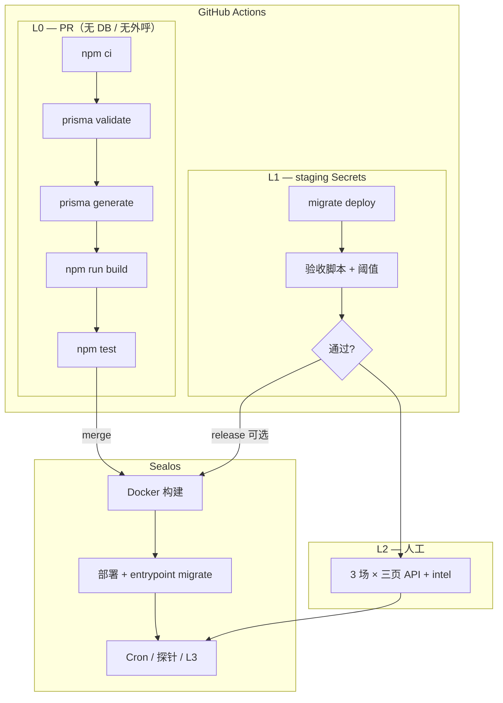

# 标化验收与 CI/CD 一体化方案（v1）

> **维护**：验收逻辑或 workflow 变更时同步本文；workflow 真源以 `.github/workflows/*.yml` 为准（落地后）。  
> **目标**：在现有 **Jest 单测（38 个 `*.spec.ts`）+ npm 验收脚本** 之上，用 **GitHub Actions** 把 **L0/L1** 自动化；**Sealos** 负责镜像构建与部署；**L2/L3** 保留人工抽检与生产观测。  
> **原则**：不新增 Nest「测试业务模块」；只增加 **workflow 配置 + 脚本 `CI_STRICT` 阈值 + 可选 Supertest E2E**。

---

## 平台决策（已定）

| 事项 | 选择 |
|------|------|
| **L0** PR 门禁 | **GitHub Actions** — `.github/workflows/ci-pr.yml` |
| **L1** nightly / 发版前 | **GitHub Actions** — `ci-nightly.yml` / `ci-release.yml` |
| **镜像构建与部署** | **Sealos** — 现有 `Dockerfile` + `entrypoint.sh`（`migrate deploy` 后启动） |
| **L1 Secrets** | GitHub → **Settings → Secrets and variables → Actions**（勿提交 Git） |
| **外呼 Key** | 默认 **不进 CI**（`API_FOOTBALL_*`、`DEEPSEEK_*` 等） |
| **Sealos 构建流水线** | **不重复跑 L0/L1**；仅构建/部署，避免与 GitHub 双跑 |

### 实施分期

| 期 | 内容 | 状态 |
|----|------|------|
| **第一期** | [`.github/workflows/ci-pr.yml`](.github/workflows/ci-pr.yml) + `npm run test:ci` | **已落地**（branch protection 需在 GitHub 手动开启） |
| **第二期** | [`ci-nightly.yml`](.github/workflows/ci-nightly.yml) + [`fixtures/ci-smoke-matches.json`](fixtures/ci-smoke-matches.json) + [`npm run ci:l1`](package.json) | **已落地**（需配置 `DATABASE_URL` Secret 后 L1 才执行） |
| **第三期** | [`ci-release.yml`](.github/workflows/ci-release.yml) + `CI_STRICT` + E2E + 文档 | **已落地** |

Secrets 与 branch protection 说明见 [`docs/ci-secrets.example.md`](docs/ci-secrets.example.md)。

### Staging 前提（第二期起）

- staging API 具备 **公网 HTTPS**（GitHub runner 可访问 `API_ORIGIN`）
- staging MySQL 允许 CI 连接（云库白名单或专用连接串）
- Secrets：`DATABASE_URL`、`API_ORIGIN`、`ADMIN_JWT`（见 §2.2）

### GitHub 合并门禁（建议）

`main` → **Branch protection** → Require status checks → 勾选 workflow **CI (L0)**（名称以 `ci-pr.yml` 中 `name:` 为准）。

---

## 1. 四层验收模型（L0–L3）

| 层级 | 名称 | 执行者 | 频率 | 失败后果 |
|------|------|--------|------|----------|
| **L0** | 构建与单测门禁 | **GitHub Actions**（PR） | 每次 push/PR | 禁止合并 |
| **L1** | 集成与指标门禁 | **GitHub Actions**（staging） | 每日 + 发版前 | 告警 / 阻塞发版 |
| **L2** | 契约与体验抽检 | QA / 开发 | 每阶段收尾、大版本前 | 阶段签收 |
| **L3** | 生产健康与业务 KPI | Sealos 生产 + 运维 | 持续 | 降级 / 回滚 |



**端到端路径**：开发者 PR → **L0 绿** → merge → Sealos 构建镜像 → 部署 →（可选）**L1 release 绿** 后发版。

---

## 2. CI/CD 流水线设计（GitHub 三条 workflow）

配置文件目录：`.github/workflows/`。

### 2.1 `ci-pr.yml` — L0（每个 PR / push 到 main）

**环境**：无 MySQL、无 AF/DeepSeek/FD Key。

| 步骤 | 命令 | 说明 |
|------|------|------|
| 安装 | `npm ci` | 与 `Dockerfile` builder 一致 |
| Schema | `npx prisma validate` | 迁移 SQL 语法合法 |
| 生成 | `npx prisma generate` | 与 build 一致 |
| 编译 | `npm run build` | 与镜像 builder 阶段一致 |
| 单测 | `npm test` | 全量 `src/**/*.spec.ts` |

**通过标准**：退出码均为 0。

**可选增强（仍属 L0）**：

- `npx jest --listTests` 写入 job summary（用例数回归）
- 失败时单独跑 `match-intel.contract.spec.ts`、`match-phase.service.spec.ts` 便于定位

**明确不进 PR CI**：

- `prediction:backtest`、`match-phase:smoke`（需 DB + API）
- `report:post-match-batch`（写库 + LLM）
- `audit:schedule`、真实 AF/FD ingest

---

### 2.2 `ci-nightly.yml` — L1（staging）

**触发**：`cron`（建议 UTC 对应北京时间凌晨）+ `workflow_dispatch`。

**Secrets**（仅 **GitHub Repository Secrets**）：

| 变量 | 用途 |
|------|------|
| `DATABASE_URL` | staging MySQL |
| `API_ORIGIN` | staging API 根地址（无末尾 `/`） |
| `ADMIN_JWT` | Admin 只读/验收 |
| `CI_STRICT` | 设为 `1` 时脚本超阈 exit 1（可在 workflow `env` 写死） |

**默认不配置**：`API_FOOTBALL_API_KEY`、`DEEPSEEK_API_KEY`、`FOOTBALL_DATA_API_KEY`。

**Job 顺序**：

```text
1. checkout → npm ci → prisma generate
2. prisma migrate deploy
3. npm run build
4. npm test
5. L1 脚本（见 §4.3）
6. 上传 Actions artifact（报告汇总）
7. 失败 → 可选飞书/钉钉 webhook
```

**通过标准**：见 §4.2；脚本约定：

```bash
CI_STRICT=1 npm run <script>
# 未达阈 → exit 1；无样本 → exit 2（nightly 可 warning，release 必须 fail）
```

---

### 2.3 `ci-release.yml` — L1 严格版 + 发版门禁

**触发**：tag `v*` 或 `workflow_dispatch`（发版前）。

与 nightly **相同 L1 脚本**，但：

- `CI_STRICT=1` 全开
- `exit 2`（无样本）视为 **失败**
- **通过后**再在 Sealos 触发构建/发布（可人工，也可后续接 webhook）

**Sealos 部署**（与 CI 分工）：

1. GitHub **L0** 已在 merge 时通过；release job 可再跑一遍 L0 或仅 L1
2. Sealos 构建：`Dockerfile` 内 `npm run build`（与 L0 一致）
3. 容器启动：`entrypoint.sh` → `prisma migrate deploy` → `node dist/main.js`
4. 部署后 smoke（人工或脚本）：`GET /health`；可选 `match-phase:smoke` 固定 `matchId`

---

## 3. 测试资产分层（不新建业务模块）

| 资产类型 | 位置 | 归属层级 |
|----------|------|----------|
| 单元/契约 Jest | `src/**/*.spec.ts`（约 38 个） | **L0** |
| HTTP 并发烟测 | `npm run test:concurrency` | **L2** 或预发手动 |
| 阶段验收脚本 | `package.json` scripts | **L1** |
| 人工 API 清单 | `测试文档-完整版.md` §3+ | **L2** |
| 生产 Cron | `src/cron/` | **L3** |

**建议新增（非阻塞第一期）**：

- `test/e2e/health.e2e-spec.ts`：Supertest `GET /health`
- `scripts/ci-exit-codes.md`：exit 0/1/2 约定
- `fixtures/ci-smoke-matches.json`、`fixtures/acceptance-matches.json`

---

## 4. 阶段 3–7 × 验收项 × 自动化映射

与 `后计划分段.md` 对齐；脚本名以 `package.json` 为准。

### 4.1 总表

| 阶段 | 能力 | L0（Jest/构建） | L1（脚本/staging） | L2（人工） | L3（生产） |
|------|------|-----------------|-------------------|------------|------------|
| **3** | AF 事实、预测版本 | `match-af-facts-sync*.spec.ts`、`prediction-*.spec.ts`、`match-odds-snapshot.service.spec.ts` | `prediction:backtest`；facts 覆盖率 | 3 场完赛三件套 | Cron sync |
| **4** | 赛中 live + SSE | `match-live/*.spec.ts` | `live-sync:latency-report` | 1 场 LIVE + SSE | P95 告警 |
| **5** | AI 报告 REVIEW | `report-fact-check`、`post-match-analysis.builder`、`ai-report-review` | `report:fact-check-sample` | 审核流 1 条 | 投诉率 |
| **6** | 三页 API | `match-phase.*`、`match-intel.contract` | `match-phase:smoke` | pre/live/post + intel | 空壳率 |
| **7** | 质量/成本/降级 | `match-facts-quality`、`supplementary-facts`、`live-key-metrics` | `ops:af-cost-report`；Admin quality API | unavailable 字段 | AF 配额 |

### 4.2 L1 量化阈值（初值，staging 跑一周后收紧）

| 指标 | 命令/来源 | 建议阈值 | 说明 |
|------|-----------|----------|------|
| Top 联赛完赛「三件套」 | Admin quality summary | **≥ 98%** | events + statistics + lineups |
| 赛中同步 P95 | `live-sync:latency-report` | **≤ 45–60s** | 与 Cron 30s 对齐 |
| 报告事实校验 | `report:fact-check-sample` | **≥ 95%** | 样本 ≥ 20 |
| 预测回测 | `prediction:backtest` | 业务自定 | 无数据 exit 2 |
| 三页 smoke | `match-phase:smoke` | 固定 matchId 全 200 | `fixtures/ci-smoke-matches.json` |
| AF 日调用 | `ops:af-cost-report` | ≤ 预算 × 1.1 | 可 warning |
| keyMetrics 降级 | live/phase 响应 | 必有 unavailable + labels | Jest + L1 HTTP |

### 4.3 L1 npm 脚本清单

```bash
npm run db:ping                    # 可选：连通性
npm run prediction:backtest        # CI_STRICT=1
npm run live-sync:latency-report
npm run report:fact-check-sample
npm run match-phase:smoke          # 需 API_ORIGIN
npm run ops:af-cost-report
# 不默认：report:post-match-batch（LLM + 写库）
```

---

## 5. L2 人工签收清单

**固定样本**：staging 上 **3 场**（未开赛 / 进行中 / 已结束），写入 `fixtures/acceptance-matches.json`。未开赛默认 **切尔西 vs 热刺** `cmpbfd6f901lap201oypcx4se`（勿用已结束的阿森纳场）。解锁详情 UI 验收：`scripts/acceptance-pre-match-unlocked.sh`（需 `ADMIN_JWT`）。

| # | 检查项 | 接口 |
|---|--------|------|
| 1 | 赛前页 | `GET /matches/:id/pre-match` |
| 2 | 赛中 + SSE | `GET .../live`、`GET .../live/stream` |
| 3 | 赛后页 | `GET .../post-match` |
| 4 | intel | `GET .../intel`（匿名/解锁） |
| 5 | 无数据降级 | `keyMetricsAvailability` / unavailable |
| 6 | Admin 质量 | quality summary、anomalies、validate-facts |

**签收模板**：

```markdown
## 阶段 X 验收签收
- 环境：staging / 日期 / 执行人
- L0：PR #___ / Actions run 链接
- L1：Nightly run ___ / artifact
- L2：上表 6 项 □通过
- 遗留项：
- 签字：
```

---

## 6. L3 生产观测（不进 GitHub CI）

| 信号 | 来源 | 动作 |
|------|------|------|
| `/health` 非 200 | Sealos 探针 | 重启 / 摘流 |
| Cron 失败 | 日志 / Admin | 告警 |
| anomalies 日增 | Admin API | 人工复核 |
| AF 超预算 | `ops:af-cost-report` | 降频 |
| 用户投诉 | 客服 | `validationLog`、`factCheckJson` |

---

## 7. 仓库落地清单

| 优先级 | 交付物 | 状态 |
|--------|--------|------|
| **P0** | [`.github/workflows/ci-pr.yml`](.github/workflows/ci-pr.yml) | 已提交 |
| **P0** | `main` branch protection → **CI (L0)** | **待你在 GitHub 开启** |
| **P1** | [`.github/workflows/ci-nightly.yml`](.github/workflows/ci-nightly.yml) | 已提交 |
| **P1** | [`fixtures/ci-smoke-matches.json`](fixtures/ci-smoke-matches.json)、[`scripts/ci-strict.util.ts`](scripts/ci-strict.util.ts) | 已提交 |
| **P2** | [`.github/workflows/ci-release.yml`](.github/workflows/ci-release.yml)、[`scripts/ci-report-aggregator.mjs`](scripts/ci-report-aggregator.mjs) | 已提交 |
| **P3** | [`test/e2e/health.e2e-spec.ts`](test/e2e/health.e2e-spec.ts)、[`scripts/ci-health-e2e.ts`](scripts/ci-health-e2e.ts) | 已提交 |
| **P3** | `测试文档-完整版.md` §2.2 | 已同步 |

### Branch protection（手动）

1. GitHub 仓库 → **Settings** → **Branches** → **Add rule**（或编辑 `main`）
2. 勾选 **Require status checks to pass before merging**
3. 搜索并勾选 **CI (L0)**（与 `ci-pr.yml` 的 `name:` 一致）
4. 可选：Require branches to be up to date

### 常用 npm 命令

| 命令 | 层级 |
|------|------|
| `npm run test:ci` | L0（PR CI 同款） |
| `npm run ci:l1` | L1 套件（需 `DATABASE_URL`） |
| `npm run ci:report` | 由 `ci-l1-report.json` 生成 `ci-l1-summary.md` |
| `npm run test:e2e` | L1/release 可选 Jest E2E |

**Sealos**：保持现有镜像构建与 `entrypoint.sh`；**不在** Sealos 流水线重复 L0/L1。

---

## 8. `ci-pr.yml` 参考骨架

```yaml
name: CI (L0)
on:
  pull_request:
  push:
    branches: [main, master]
jobs:
  build-test:
    runs-on: ubuntu-latest
    steps:
      - uses: actions/checkout@v4
      - uses: actions/setup-node@v4
        with:
          node-version: "20"
          cache: npm
      - run: npm ci
      - run: npx prisma validate
      - run: npx prisma generate
      - run: npm run build
      - run: npm run test:ci
```

---

## 9. 与现有文档的关系

| 文档 | 角色 |
|------|------|
| `测试文档-完整版.md` | L2 手工步骤、鉴权、curl |
| `后计划分段.md` | 阶段 3–7 做什么 |
| **本文** | 怎么验收、GitHub/Sealos 分工、阈值 |
| `环境变量配置.md` | 含 **CI / GitHub Actions** 小节 |
| `docs/ci-secrets.example.md` | Actions Secrets 配置清单 |
| `scripts/ci-exit-codes.md` | 验收脚本 exit 0/1/2 |
| `验收对照.md` / `开发进度.md` | 可附 CI 分期进度 |
| `并发测试结果.md` | L2/L3 容量参考 |

---

## 10. 结论

- **L0/L1**：**GitHub Actions**；**部署**：**Sealos**。  
- **代码已落地**；你方待办：GitHub **Secrets**（staging `DATABASE_URL`）、**branch protection**、staging 稳定 `matchId` 写入 fixtures。  
- **L2/L3** 不变；指标与 `后计划分段.md` 阶段 3–7 对应。
